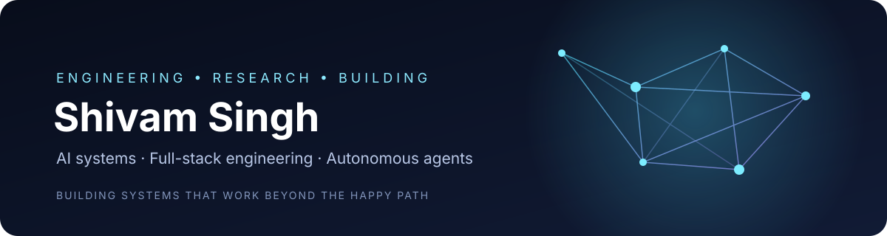

<!-- GitHub profile README for Shivam Singh -->

  <a href="https://shivam-engineering-portfolio-721189s-projects.vercel.app/">Live Portfolio</a> ·
  <a href="https://www.linkedin.com/in/shivam-singh360">LinkedIn</a> ·
  <a href="https://github.com/721189?tab=repositories">Projects</a> ·
  <a href="https://shivlab.substack.com/">Writing</a>

---

## Interactive engineering portfolio

Explore my interactive portfolio featuring a live 3D systems visualisation, selected engineering projects, research interests, and live GitHub metrics.

**[Open the live portfolio →](https://shivam-engineering-portfolio-721189s-projects.vercel.app/)** · [View source code](https://github.com/721189/721189/tree/main/portfolio)

## About

I'm an engineering student at **IIT Madras**, focused on building practical software at the intersection of **AI engineering, full-stack systems, and autonomous agents**.

I enjoy taking ideas from architecture to implementation: designing APIs, building data and retrieval pipelines, integrating models and tools, testing failure paths, and deploying usable products.

My current interests include:

- **AI engineering:** agentic workflows, RAG, retrieval, evaluation, and grounded generation.
- **Systems engineering:** distributed services, observability, reliability, and security.
- **Autonomous systems:** multi-agent coordination, swarm robotics, and simulation.
- **Product engineering:** turning technically ambitious ideas into maintainable software.

> I care about systems that remain useful when conditions stop being ideal.

## Selected work

### 01 · [Synapse Memory](https://github.com/721189/Synapse-Memory)
**Persistent memory infrastructure for AI applications**

A self-hostable memory layer designed for applications that need durable, retrievable, tenant-aware context.

- Hybrid retrieval combining lexical and vector search.
- Token-budget-aware context selection.
- PostgreSQL-backed storage and tenant isolation.
- Python SDK, HTTP API, and developer-facing observability.

Python · FastAPI · PostgreSQL · pgvector · Node.js · React

[PyPI package](https://pypi.org/project/synapse-memory-engine/) · [Repository](https://github.com/721189/Synapse-Memory)

### 02 · [AetherLab](https://github.com/721189/AetherLab)
**Environmental intelligence and autonomous-agent platform**

A platform that brings geospatial and environmental observations together with evidence-grounded AI workflows.

- Integrates weather, air-quality, satellite, and reanalysis data sources.
- Tracks observation provenance and uncertainty.
- Uses a provider-based ingestion architecture and asynchronous processing.
- Connects retrieved evidence to AI-generated analysis.

Python · FastAPI · Next.js · PostgreSQL · Redis · Celery

[Repository](https://github.com/721189/AetherLab)

### 03 · [SWARMOS](https://github.com/721189/SWARMOS)
**Secure and resilient swarm orchestration research**

A research-oriented framework exploring decentralized coordination under communication degradation, failures, and adversarial inputs.

- CBBA-based task allocation and coordination.
- Anomaly-aware validation and node isolation.
- Failure injection, recovery mechanisms, and stress testing.
- Reproducible experiments and statistical evaluation.

[Repository](https://github.com/721189/SWARMOS)

### 04 · [Swarm Robotics](https://github.com/721189/swarm-robotics)
**Communication-constrained multi-agent simulation**

A simulation environment for studying decentralized robot coordination with realistic communication constraints.

- Local-neighbour coordination and task allocation.
- TDMA scheduling and packet-loss modelling.
- Fault recovery and performance measurements.
- 2D/3D simulation visualizations and reproducible experiments.

[Live simulation](https://swarm-robotics-cufdk4uidsgg22595mggw3.streamlit.app/) · [Repository](https://github.com/721189/swarm-robotics)

### 05 · [Market Metrics](https://github.com/721189/Market-Metrics)
**Evidence-first market research system**

An autonomous research workflow designed around a clear separation between source evidence, model reasoning, and deterministic calculations.

- Source discovery and evidence extraction.
- Claim verification and citation-oriented reporting.
- Structured research workflows and live progress events.
- Deterministic financial calculations.

[Repository](https://github.com/721189/Market-Metrics)

### 06 · [OmniApply Agent](https://github.com/721189/OmniApply-Agent)
**AI-assisted career workflow automation**

An agent-oriented application for organizing job research and preparing application materials from a candidate's technical footprint.

[Repository](https://github.com/721189/OmniApply-Agent)

---

## Technical toolkit

**Languages**

**Frameworks & infrastructure**

I use these tools across projects; the exact stack varies by repository.

## Research interests

- Multi-agent systems and swarm robotics
- Decentralized coordination and consensus
- Communication-constrained systems
- Fault tolerance and resilient autonomy
- Applied machine learning and reinforcement learning
- Reliable, evidence-grounded AI systems

## Education

**Indian Institute of Technology Madras**  
BS in Data Science and Applications · 2026–Present

## GitHub activity

  
  

  

## Let's connect

I'm interested in thoughtful engineering collaborations, AI systems, autonomous agents, and research conversations.

- **LinkedIn:** [shivam-singh360](https://www.linkedin.com/in/shivam-singh360)
- **GitHub:** [@721189](https://github.com/721189)
- **Writing:** [ShivLab](https://shivlab.substack.com/)

*Build carefully. Measure honestly. Make it work in the real world.*

